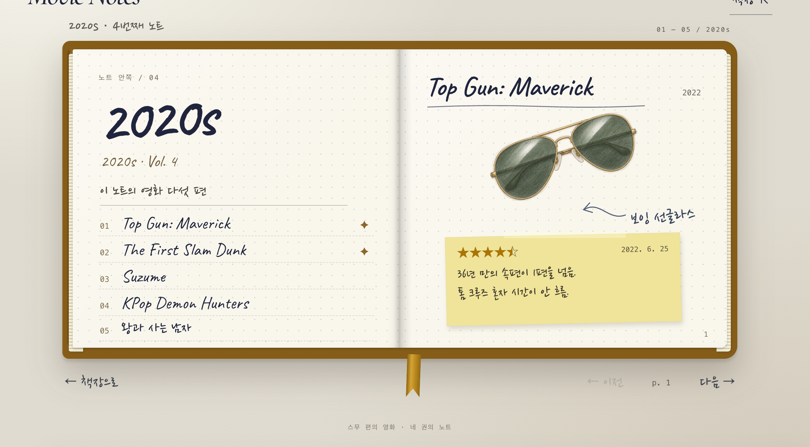

# 제작·검증 기록: Movie Notes — 나의 영화 기록 노트

## 두 AI 비교
- AI A (서비스·모델 이름):
  - **Claude** (claude.ai 채팅) · **Claude Opus 5.5**
- AI B (서비스·모델 이름):
  - **ChatGPT** (Chat) · **GPT-6 Extra High (Sol)**
- 동일한 기획서와 함께 전달한 요청:
  - 첨부(A·B 같음): `기획서.md` · `movies.csv` · `image_urls.md`(그림 25장 주소)
  - 요청 문장(A·B 같음):

    > 이 기획서대로 HTML·CSS·JavaScript가 모두 들어 있는 HTML 파일 하나를 만들어 줘.
    > 다른 파일 없이 이 파일 하나로 브라우저에서 바로 열리게 하고, 화면 문구는 한국어로 써 줘.
    > 그림과 글씨체는 첨부한 https:// 주소로 불러와 줘. 주소는 지어내지 마.
    > 로그인·API 키·서버가 필요한 기능과 챗봇·AI 기능은 넣지 마.
    > 완성된 .html 파일로 제공해 줘.

| 테스트 내용 | AI A | AI B |
| --- | --- | --- |
| 1990s 노트 누르기 | 차례와 p.1이 나옴. 접힌 책이 앞으로 나왔다가 열림 | 차례와 p.1이 나옴. 나오면서 바로 열림 |
| `다음 →`을 끝까지 누르기 | 마지막에서 `다음 →`이 흐려지고 멈춤 | 마지막에서 `다음 →`이 흐려지고 멈춤 |
| 색 탭에 마우스를 올렸다가 누르기 | 영화 제목이 뜨고, 누르면 그 영화로 감 | 영화 제목이 뜨고, 누르면 그 영화로 감 |

- 선택한 결과물과 근거:
  - **A** 선택 → `movie-notes_v1.html`
  - A의 노트 비율이 B보다 좋다.
  - B는 노트 위아래의 작은 글씨들이 복잡하다.
  - 공책이 펼쳐질 때 A가 더 실제처럼 펼쳐진다.
  - 선택하지 않은 B의 결과:
    - 브라우저로 열면 그림이 잘 뜨고, 노트에 마우스를 올리면 살짝 떠오름
    - 노트를 누르면 나오면서 바로 열림
    - 펼친 노트 위아래에 작은 글씨들이 있어 복잡함
    - B 화면 캡처(2020s 첫 펼침면):

      

## 테스트 기록
| 번호 | 테스트 내용 | 예상 결과 | 실제 결과 |
| --- | --- | --- | --- |
| 1 | 2010s 노트를 펼치고 왼쪽 차례에서 `기생충` 누르기 | 기생충이 있는 펼침면(p. 4–5)이 열린다 | 예상대로 열림 |
| 2 | 1990s 노트 펼치기 → `다음 →` 한 번 → `← 책장으로` → 2020s 노트 누르기 | 책장으로 돌아오고, 2020s는 첫 펼침면(Vol. 4 차례 + p.1)부터 나온다 | 예상대로 됨 |
| 3 (좁은 화면·빈칸 입력·인쇄 등 조건을 바꿔 테스트) | Chrome 휴대폰 보기(폭 400px)로 열고, 노트를 펼친 뒤 쪽을 옆으로 밀기 | 선반이 한 줄 그대로 줄고 연도가 책 아래 큰 글씨로 뜬다. 펼치면 한 쪽씩 보이고 밀어서 넘어간다 | 선반이 한 줄로 줄고 연도가 책 아래 큰 글씨로 뜸. 펼치면 한 쪽씩 보이고, 밀면 다음 쪽으로 넘어감. 다만 넘기는 느낌이 아니라 미끄러지듯 바뀜. 책이라기보다 판에 종이를 댄 것처럼 보임 |

## 수정 기록

### 수정 기록 1
- 발견한 문제:
- AI에게 전달한 요청:
- 수정 후 테스트 결과:
- 수정 이유:

### 수정 기록 2
- 발견한 문제:
- AI에게 전달한 요청:
- 수정 후 테스트 결과:
- 수정 이유:

### 수정 기록 3
- 발견한 문제:
- AI에게 전달한 요청:
- 수정 후 테스트 결과:
- 수정 이유:

## 사용자 테스트
- 테스트 참여자와 요청한 작업:
- 사용자의 행동과 질문:
- 받은 피드백:
- 반영 내용과 결과:

## 덧붙임
- 그림 25장은 이 저장소 `mission6/sketches/`·`mission6/shelf/`에 올리고 https:// 주소로 불러왔다.
- 비교 행동을 고른 이유
  - 노트 누르기: 가장 기본이라 잘 작동하는지 확인하고 싶어서
  - `다음 →` 끝까지: 페이지 넘기기가 이 페이지에서 가장 많이 쓰는 동작이라서
  - 색 탭: 오류가 가장 날 것 같아서
- 테스트는 모두 브라우저로 열어서 했다. Finder·아이폰 파일 미리보기로 열면 그림과 노트가 뜨지 않아 결과에서 뺐다.
- 수정 기록·사용자 테스트는 다음 미션에서 채운다.
