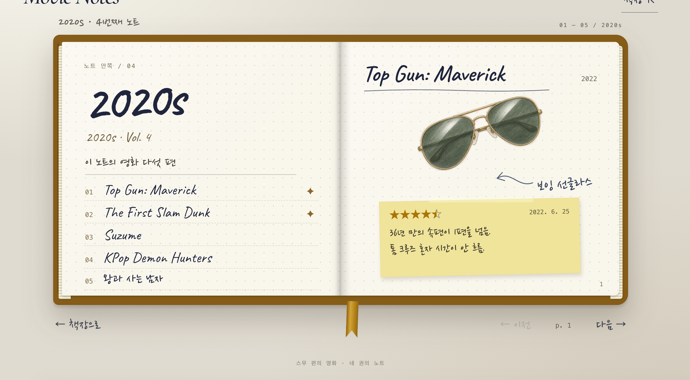

# 제작·검증 기록: Movie Notes — 나의 영화 기록 노트

## 두 AI 비교
- AI A (서비스·모델 이름):
  - **Claude** (claude.ai 채팅) · **Claude Opus 5.5**
- AI B (서비스·모델 이름):
  - **ChatGPT** (Chat) · **GPT-6 Extra High (Sol)**
- 동일한 기획서와 함께 전달한 요청:
  - 첨부(A·B 같음): `기획서.md` · `movies.csv` · `image_urls.md`(그림 25장 주소)
  - 요청 문장(A·B 같음):

    > 이 기획서대로 HTML·CSS·JavaScript가 모두 들어 있는 HTML 파일 하나를 만들어 줘.
    > 다른 파일 없이 이 파일 하나로 브라우저에서 바로 열리게 하고, 화면 문구는 한국어로 써 줘.
    > 그림과 글씨체는 첨부한 https:// 주소로 불러와 줘. 주소는 지어내지 마.
    > 로그인·API 키·서버가 필요한 기능과 챗봇·AI 기능은 넣지 마.
    > 완성된 .html 파일로 제공해 줘.

| 테스트 내용 | AI A | AI B |
| --- | --- | --- |
| 1990s 노트 누르기 | 차례와 p.1이 나옴. 접힌 책이 앞으로 나왔다가 열림 | 차례와 p.1이 나옴. 나오면서 바로 열림 |
| `다음 →`을 끝까지 누르기 | 마지막에서 `다음 →`이 흐려지고 멈춤 | 마지막에서 `다음 →`이 흐려지고 멈춤 |
| 색 탭에 마우스를 올렸다가 누르기 | 영화 제목이 뜨고, 누르면 그 영화로 감 | 영화 제목이 뜨고, 누르면 그 영화로 감 |

- 선택한 결과물과 근거:
  - **A** 선택 → `movie-notes_v1.html`
  - A의 노트 비율이 B보다 좋다.
  - B는 노트 위아래의 작은 글씨들이 복잡하다.
  - 공책이 펼쳐질 때 A가 더 실제처럼 펼쳐진다.
  - 선택하지 않은 B의 결과:
    - 브라우저로 열면 그림이 잘 뜨고, 노트에 마우스를 올리면 살짝 떠오름
    - 노트를 누르면 나오면서 바로 열림
    - 펼친 노트 위아래에 작은 글씨들이 있어 복잡함
    - B 화면 캡처(2020s 첫 펼침면):

      

## 테스트 기록
| 번호 | 테스트 내용 | 예상 결과 | 실제 결과 |
| --- | --- | --- | --- |
| 1 | 2010s 노트를 펼치고 왼쪽 차례에서 `기생충` 누르기 | 기생충이 있는 펼침면(p. 4–5)이 열린다 | 예상대로 열림 |
| 2 | 1990s 노트 펼치기 → `다음 →` 한 번 → `← 책장으로` → 2020s 노트 누르기 | 책장으로 돌아오고, 2020s는 첫 펼침면(Vol. 4 차례 + p.1)부터 나온다 | 예상대로 됨 |
| 3 (좁은 화면·빈칸 입력·인쇄 등 조건을 바꿔 테스트) | Chrome 휴대폰 보기(폭 400px)로 열고, 노트를 펼친 뒤 쪽을 옆으로 밀기 | 선반이 한 줄 그대로 줄고 연도가 책 아래 큰 글씨로 뜬다. 펼치면 한 쪽씩 보이고 밀어서 넘어간다 | 선반이 한 줄로 줄고 연도가 책 아래 큰 글씨로 뜸. 펼치면 한 쪽씩 보이고, 밀면 다음 쪽으로 넘어감. 다만 넘기는 느낌이 아니라 미끄러지듯 바뀜. 책이라기보다 판에 종이를 댄 것처럼 보임 |

## 수정 기록

### 수정 기록 1
- 발견한 문제:
  - 테스트: Chrome 휴대폰 보기(폭 400px)로 노트를 펼친 뒤 쪽을 옆으로 밀었다.
  - 예상: 공책 종이를 넘기듯 쪽이 넘어간다.
  - 실제: 다음 쪽으로 넘어가긴 하는데, **옆으로 미끄러지듯** 바뀐다. (테스트 기록 3에서 예상과 달랐던 것이라 가장 먼저 고침)
- AI에게 전달한 요청:
  - **Claude**(v1을 만든 창)에 `movie-notes_v1.html`을 첨부하고 요청

    > 이 HTML을 Chrome 휴대폰 보기(폭 400px)로 테스트했어.
    > 한 일: 노트를 펼친 뒤 쪽을 옆으로 밀었어.
    > 예상한 결과: 공책 종이를 넘기듯 쪽이 넘어간다.
    > 실제로 보인 것: 다음 쪽으로 넘어가긴 하는데, 종이를 넘기는 느낌이 아니라 옆으로 미끄러지듯 바뀐다.
    > 이 문제 하나만 고쳐 줘. 폰에서 밀면 종이가 넘어가는 것처럼 보이게 해 줘.
    > 다른 기능과 화면은 그대로 두고, 고친 HTML 전체를 파일로 줘.
- 수정 후 테스트 결과:
  - `movie-notes_v2.html` — 쪽이 넘어가긴 하지만, 종이라기보다 **딱딱한 카드**가 넘어가는 느낌.
  - 책 왼쪽 옆이 없어서 더 그렇게 보인다고 느껴, 다음 수정(수정 기록 2)에서 책 모양부터 고치기로 함.
  - 원래 기능: PC(노트 누르기, `다음 →` 끝까지, 색 탭, 책장 → 다른 노트)와 폰 끝까지 넘기기 모두 됨.
- 수정 이유:
  - 공책 콘셉트에서 가장 중요한 동작이 **쪽 넘기기**다. 미끄러지듯 바뀌면 공책이 아니라 슬라이드 화면처럼 느껴진다.

### 수정 기록 2
- 발견한 문제:
  - 테스트: Chrome 휴대폰 보기(폭 400px)로 노트를 펼치고 쪽을 밀어서 넘겼다.
  - 예상: 공책 한 권이 펼쳐진 모습이고, 종이가 넘어간다.
  - 실제: 책이라기보다 **판에 종이를 댄 것처럼** 보이고, 펼친 쪽의 왼쪽에 책 옆면이 보이지 않는다.
- AI에게 전달한 요청:
  - **Claude**(같은 창)에 `movie-notes_v2.html`을 첨부하고 요청 — "폰에서도 펼친 공책처럼 왼쪽에 책 옆면이 보이게 해 줘."
  - 작업 중 화면을 보니 한 쪽짜리 종이 왼쪽에 얇은 옆면 띠가 붙은 모습이라, 원한 모습(펼친 공책을 오른쪽 쪽으로 바짝 당겨 본 모습)과 달랐다. **공책 사진 1장**을 첨부해 다시 요청

    > 예상한 결과: 첨부한 사진처럼 펼친 공책을 오른쪽 쪽 쪽으로 바짝 당겨 본 모습. 오른쪽 쪽이 화면을 거의 다 차지하고, 왼쪽 쪽은 가는 띠만큼 보이다가 화면 왼쪽 끝에서 잘린다. 가운데 접히는 선이 살짝 휘어 보이고 리본이 거기서 늘어진다.
    > 실제로 보인 것: 한 쪽짜리 종이 왼쪽에 얇은 책 옆면이 붙어 있어서, 펼친 책이 아니라 덮인 책 위에 종이 한 장이 있는 것처럼 보인다.
    > 이 문제 하나만 고쳐 줘. 폰에서 펼친 노트가 첨부한 사진처럼 보이게 해 줘. 사진은 모양 참고용이고, 색과 그림은 지금 페이지 것을 그대로 써 줘.
- 수정 후 테스트 결과:
  - `movie-notes_v3.html` — 폰에서 펼친 공책이 사진처럼 보이고, 끝까지 밀어서 넘기기도 됨.
  - 원래 기능: PC(노트 누르기·`다음 →` 끝까지, 색 탭, 책장 → 다른 노트) 모두 됨.
- 수정 이유:
  - 판에 종이를 댄 모습이면 폰으로 보는 사람에게 **노트라는 느낌**이 전해지지 않는다.

### 수정 기록 3
- 발견한 문제:
  - 테스트: 노트를 펼쳐 펼침면을 봤다.
  - 예상: 차분하게 읽히는 공책 펼침면.
  - 실제: 왼쪽·오른쪽 쪽에 모두 영화 기록과 그림이 있어 **정신없다**.
- AI에게 전달한 요청:
  - **Claude**(같은 창)에 `movie-notes_v3.html`을 첨부하고 요청 — "영화 한 편이 펼침면 하나를 쓰게 해서, 왼쪽 쪽은 빈 종이로 두고 오른쪽 쪽에만 영화 기록을 넣어 줘. … 폰에서는 빈 쪽은 건너뛰고 영화 기록 쪽만 넘어가게 해 줘."
  - 결과(`v4`)의 첫 펼침면이 왼쪽 차례·오른쪽 첫 영화라, 원한 모습과 달라 다시 요청

    > 예상한 결과: 첫 펼침면은 왼쪽이 빈 종이, 오른쪽이 차례. 한 장 넘기면 왼쪽은 빈 종이, 오른쪽은 첫 영화. 그 뒤로도 왼쪽은 빈 종이, 오른쪽에 다음 영화가 하나씩 나온다.
    > 실제로 보인 것: 첫 펼침면에 왼쪽 차례, 오른쪽 첫 영화가 함께 나온다.
    > 이 문제 하나만 고쳐 줘. 차례도 오른쪽 쪽에 두고, 모든 내용은 오른쪽 쪽에만, 왼쪽 쪽은 늘 빈 종이로 해 줘.
- 수정 후 테스트 결과:
  - `movie-notes_v5.html` — 왼쪽을 빈 쪽으로 바꾸니 **펼침면이 훨씬 예뻐졌다**. 한 권이 펼침면 6개(차례 1 + 영화 5)가 됨.
- 수정 이유:
  - 한 펼침면에 영화 두 편과 그림 두 개가 있으면 눈이 어디에 머물지 몰라, 영화 한 편을 **노트의 한 쪽**으로 보여 준다는 목적이 흐려진다.

### 수정 기록 4
- 발견한 문제:
  - 테스트: 노트를 펼쳐 차례 쪽과 영화 쪽을 읽었다.
  - 예상: 글씨가 잘 읽히고 여백이 있는 쪽.
  - 실제: 화면이 꽉꽉 들어차 있고, 손글씨 글씨체가 **굵은 느낌이라 잘 안 읽힌다**. 그림이 크고 제목과 그림 사이가 붙어 있다.
- AI에게 전달한 요청:
  - ① **Claude**(같은 창)에 v5를 첨부하고 "글씨체는 명조로 바꾸고, 그림은 조금 작게 해 줘" → 결과(`v6a`)는 글씨가 너무 크고 줄 간격도 별로라 **v5로 되돌림**.
  - ② **Claude 새 창**(Claude Opus 5.5)에 v5만 주고, 차례 쪽·영화 쪽을 글씨·크기·줄 간격·그림 크기를 다르게 한 비교 안 3개를 요청 → 세 안 모두 v5의 배치는 그대로 두고 숫자만 바뀌어, 영화 쪽이 다 마음에 들지 않음(그림이 크고, 제목과 그림이 붙고, 포스트잇이 옆으로 치우침).
  - ③ 지금 디자인을 주고 고쳐 달라고 하니 그 틀 안에서만 바뀌어서, **아예 다른 맥락**에서 레퍼런스 없이 설명만 주기로 함. **ChatGPT** 새 창에 지금 디자인은 보여 주지 않고, 필수 요소(제목·연도·그림·한마디·포스트잇·쪽 번호, 차례 5줄)와 표지 사진·투구 그림만 주고 **처음부터 다른 속지 디자인 3안**을 요청 → **01 정갈한 책 속지**를 고름.
  - ④ 01은 손글씨 기운이 없어 많이 차가워서, 같은 창에 손글씨를 넣는 정도만 다르게 한 변형 3개를 요청. 손글씨는 직접 **더페이스샵 잉크립퀴드체**로 지정(무료, 웹 사용 허용, 기울이기 금지) → **변형 3**(한마디·별점·날짜·메모까지 손글씨)을 고르고 한마디 아래 밑줄은 뺌.
  - ⑤ 같은 ChatGPT 창에 v5와 변형 3 파일을 첨부하고 적용을 요청 — 밑줄 빼기, 차례는 '제목 (연도) ……… 쪽 번호'로 누르는 줄처럼 보이게, 색 탭 표시는 v5처럼 유지, 20편 모두 넘치지 않게.
  - ⑥ 결과를 보고 두 번 손질 요청 — "차례 글씨가 흐리고 작다, 본문 글씨 조금씩 크게, 포스트잇에 그림자" → "차례의 글자·점선·쪽 번호를 아주 약간씩 더 크고 굵게".
- 수정 후 테스트 결과:
  - `movie-notes_v6.html` — 전체적으로 **많이 깔끔해짐**. 차례 글씨는 흐리고 작음.
  - `movie-notes_v7.html` — 영화 쪽 괜찮음, 긴 제목(The Lord of the Rings 등) 괜찮음, 폰 기능 다 됨. 차례는 디자인은 예쁘나 여전히 작아서 한눈에 안 들어옴.
  - `movie-notes_v8.html` — 차례가 **정말 좋아짐**.
- 수정 이유:
  - 글씨가 잘 안 읽히고 화면이 꽉 차 있으면, 구경하러 온 사람이 영화 기록을 읽기 전에 지친다.

### 수정 기록 5
- 발견한 문제:
  - 테스트: 펼친 노트에서 책장으로 가는 버튼을 찾았다.
  - 예상: 책장으로 가는 버튼이 한 곳에 있다.
  - 실제: 위(`책장` 메뉴)와 아래(`← 책장으로`) **두 곳**에 있다.
- AI에게 전달한 요청:
  - **ChatGPT**(같은 창)에 `movie-notes_v8.html`을 첨부하고 요청

    > 이 문제 하나만 고쳐 줘. 위의 '책장' 메뉴만 남기고 아래 '← 책장으로'는 없애 줘.
    > 다른 기능과 화면은 그대로 두고, 고친 HTML 전체를 파일로 줘.
- 수정 후 테스트 결과:
  - `movie-notes_v9.html` — 아래 버튼이 없어지고 위 `책장`으로 돌아감. PC(노트 누르기·`다음 →` 끝까지, 차례·색 탭, 책장 → 다른 노트)와 폰 모두 됨.
- 수정 이유:
  - 같은 일을 하는 버튼이 두 곳에 있으면 처음 보는 사람이 둘이 다른 기능인지 헷갈린다.

### 수정 기록 6
- 발견한 문제:
  - 테스트: 노트를 펼치고 쪽을 넘기려고 버튼을 찾았다.
  - 예상: 진짜 공책처럼 쪽의 **아래 귀퉁이**를 눌러 넘긴다.
  - 실제: `← 이전`과 `다음 →`이 책 밖 아래에 있고, `p. 1` 쪽 표시도 따로 있다.
- AI에게 전달한 요청:
  - **ChatGPT**(같은 창)에 `movie-notes_v9.html`을 첨부하고 요청

    > 이 문제 하나만 고쳐 줘. 왼쪽 쪽 좌하단을 누르면 이전, 오른쪽 쪽 우하단 쪽 번호를 누르면 다음으로 넘어가게 하고, 그 귀퉁이는 살짝 접힌 모양으로 보이게 해 줘. 책 밖의 '← 이전' '다음 →'과 'p.' 쪽 표시는 없애 줘.
    > 폰에서는 왼쪽 쪽이 잘려 보이니까, 보이는 쪽의 좌하단을 누르면 이전, 우하단을 누르면 다음으로 해 줘. 밀어서 넘기기는 그대로 둬.
    > 첫 쪽에서는 이전 귀퉁이, 마지막 쪽에서는 다음 귀퉁이가 눌리지 않게 해 줘.
- 수정 후 테스트 결과:
  - `movie-notes_v10.html` — 책 밖 버튼이 없어지고, 접힌 귀퉁이를 누르면 잘 넘어감.
  - 귀퉁이가 작아서 처음 보는 사람이 눌러 볼 생각을 못 할까 걱정됨 → 사용자 테스트에서 동료가 **바로 눌러 넘겨** 걱정이 풀림.
- 수정 이유:
  - 넘기는 버튼이 책 밖에 있으면 공책을 넘기는 손맛이 없다. 진짜 공책에서 손이 가는 자리가 아래 귀퉁이다.

## 사용자 테스트
- 테스트 참여자와 요청한 작업:
  - 참여자: **동료 1명** (이 페이지를 처음 봄)
  - 요청한 작업: "편하게 구경하면서 불편한 점이나 덧붙이면 좋을 기능 아이디어를 말해 줘." (사용법은 설명하지 않음)
- 사용자의 행동과 질문:
  - 노트를 펼친 뒤 **귀퉁이를 바로 눌러** 넘김.
  - 차례 아래 `다시 보고 싶은 페이지`를 **눌러 봄**.
  - 점검한 기능은 모두 잘 작동함.
- 받은 피드백:
  1. `다시 보고 싶은 페이지` 부분이 모호해서 무슨 말인지 모르겠다. 눌러 보게 된다.
  2. 1990s·2000s가 내가 영화를 본 연대인지, 영화가 만들어진 연대인지 헷갈린다.
  3. 2를 해결하려면 설명이나 표지에 이 연도가 무슨 연도인지 적어 두면 좋겠다.
- 반영 내용과 결과:
  - **2·3번 반영** — 노트는 원래 기획서대로 **개봉 연대**다(본 날로 나누면 2018~2026년이라 두 권만 남음). 그래서 무슨 연도인지 적기로 함.
    - ChatGPT(같은 창)에 v10을 첨부하고 "책장 화면 왼쪽 위 큰 제목 'Movie Notes' 아래에 '개봉 연도별 노트'라는 뜻이 보이게 작은 글씨로 적어 줘"라고 요청 → `movie-notes_v11.html`: 제목 아래가 네 줄이 되어 너무 많음.
    - 다시 "새로 넣은 줄은 없애고, 맨 윗줄을 'A MOVIE NOTEBOOK · 개봉 연도별 · 1990 — 2026'으로 바꿔 줘"라고 요청 → `movie-notes_v12.html`: 세 줄을 유지하면서 맨 윗줄에 개봉 연도별이 표시됨. PC·폰 기능 모두 됨.
    - 정식 배포라면 글씨를 키우거나 자리를 옮기겠지만, 이번 과제에서는 여기까지로 함.
  - **1번은 반영하지 않음** — 이번 과제에서는 여기까지 하고, 기획서의 '추가 기능'에 남김.

## 덧붙임
- 그림 25장은 이 저장소 `mission6/sketches/`·`mission6/shelf/`에 있고 https:// 주소로 불러온다. 손글씨(잉크립퀴드체)는 눈누 웹폰트 주소로 불러온다.
- 미션 6 비교 행동을 고른 이유
  - 노트 누르기: 가장 기본이라 잘 작동하는지 확인하고 싶어서
  - `다음 →` 끝까지: 페이지 넘기기가 이 페이지에서 가장 많이 쓰는 동작이라서
  - 색 탭: 오류가 가장 날 것 같아서
- 테스트는 모두 브라우저로 열어서 했다. Finder·아이폰 파일 미리보기로 열면 그림과 노트가 뜨지 않아 결과에서 뺐다. 폰 테스트는 Chrome 휴대폰 보기로 했다.
- 버전별 파일

| 파일 | 내용 | 고친 AI |
| --- | --- | --- |
| v1 | 미션 6에서 고른 A | Claude |
| v2 | 수정 1 · 폰 종이 넘김 | Claude |
| v3 | 수정 2 · 폰에서 펼친 공책 모양 | Claude |
| v4 | 수정 3 첫 시도 (차례가 왼쪽) | Claude |
| v5 | 수정 3 · 왼쪽 빈 종이, 오른쪽에만 기록 | Claude |
| v6a | 수정 4 첫 시도 (되돌림) | Claude |
| v6 | 수정 4 · 속지 디자인 적용 | ChatGPT |
| v7 | 수정 4 · 글씨·포스트잇 손질 | ChatGPT |
| v8 | 수정 4 · 차례 손질 | ChatGPT |
| v9 | 수정 5 · 책장 버튼 하나로 | ChatGPT |
| v10 | 수정 6 · 귀퉁이로 넘기기 | ChatGPT |
| v11 | 피드백 반영 첫 시도 (네 줄) | ChatGPT |
| **v12** | **피드백 반영 · 최종** | ChatGPT |

- 계속 쓴다면 개선할 것
  - Chrome 휴대폰 보기로 책장 화면을 보면, 세로 화면에서 선반 위아래가 **매우 휑하다**. 가로로 긴 선반 한 줄을 세로 화면에 그대로 줄여 넣었기 때문이다.
  - 손볼 방향 후보(Claude 제안): 선반을 두 줄로 쌓기, 책을 키워 화면 가운데로 올리기, 빈 곳에 눌러서 갈 수 있는 쪽지 두기.

## 미션 7에서 배운 것

**Before** 마음에 안 들면 지금 화면을 주고 원하는 것을 한 번에 말하면서 "이렇게 바꿔 줘"라고 요청한 후, 안 되면 계속 고쳐 달라고 했다.

**After**
- 고칠 때는 본 것(한 일·예상·실제)을 한 번에 하나씩 전한다.
- 디자인처럼 틀 자체를 바꿀 때는 지금 시안을 보여 주지 않는다.
- 필수 요소만 주어 처음부터 여러 안을 받아 고른다.

- 세부 디자인 문제는 메인 창에서 너무 깊어지지 않게 다른 창에서 작업해서 가져온다. 안 세 개를 받아서 그중에 정한다.
- 처음에 손글씨 방향으로 시작했더니, 그 뒤로는 그 라인 안에서만 고쳐지고 바뀌지 않았다. 바꾸려면 기존 시안을 보여 주지 말고 필수 요소만 주고 처음부터 새로 시켜야 한다.
- AI들이 고르는 손글씨는 무지무지 촌스럽다. 원하는 손글씨는 직접 이름을 지정해야 한다.
- 디자인이 중요하다. 같은 내용인데 바꾸니까 뽀다구가 다르다.
